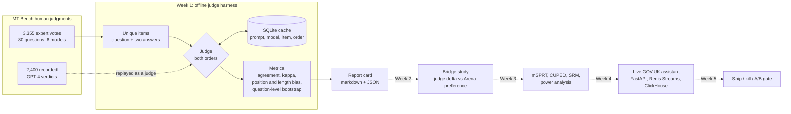

# EvalBridge: do your offline LLM evals predict what users prefer?

[](https://github.com/chanoch01/evalbridge/actions/workflows/ci.yml)

EvalBridge checks whether a team's LLM-as-judge scores agree with what people actually prefer, then turns that evidence into a ship, kill or A/B-test decision for each change.

> **Status: Week 1 of 5.** The offline judge harness and the judge report card work, are tested, and have been run on the real MT-Bench expert judgments. The bridge study (Week 2), statistics package (Week 3), live assistant (Week 4) and decision gate (Week 5) are still to come, as typed stubs. See [Roadmap](#roadmap).

## The problem

Teams ship prompt and model changes because an LLM judge says the new version is better. That judge is rarely checked against people. If it mostly rewards longer answers, or whichever answer it reads first, a "win" offline can be a loss with users, and nobody finds out until the A/B test, or never. Before trusting a judge to gate changes, you need to know how often it agrees with careful humans, and what kinds of bias it has.

## How it works



| Step | Code | What it does |
| --- | --- | --- |
| Load | [`data.py`](src/evalbridge/data.py) | Downloads a pinned revision of `lmsys/mt_bench_human_judgments`, normalises `tie` variants, and splits votes into unique items (turn 1 by default; turn 2 shows the earlier exchange as context) |
| Judge | [`judges.py`](src/evalbridge/judges.py) | A `Judge` protocol, `(question, answer_a, answer_b) -> "A" / "B" / "tie"`, plus `LongerAnswerJudge`, `FirstPositionJudge` and `RecordedJudge` (replays MT-Bench's GPT-4 verdicts) |
| LLM judge | [`llm.py`](src/evalbridge/llm.py), [`prompts/pairwise_v1.md`](src/evalbridge/prompts/pairwise_v1.md) | OpenAI-compatible or Anthropic API, set in `.env`; versioned prompt; strict `[[A]]/[[B]]/[[C]]` parsing; retries with backoff on 429 and 5xx (honours `Retry-After`); SQLite cache so re-runs cost nothing |
| Run | [`harness.py`](src/evalbridge/harness.py) | Judges each item as shown and swapped, then maps verdicts onto every human vote in the order that voter saw |
| Measure | [`metrics.py`](src/evalbridge/metrics.py) | Agreement with and without ties, three-class Cohen's kappa, cluster bootstrap CIs, swap consistency, first-position win rate, prefers-longer rate, human-vs-human agreement |
| Report | [`report.py`](src/evalbridge/report.py), [`cli.py`](src/evalbridge/cli.py) | `evalbridge report --judge longer --limit N --out reports/` writes the report card as `.md` and `.json`, with both baselines and human-vs-human agreement as reference points |

## Run it

You need Python 3.11+.

```bash
python -m venv .venv && source .venv/bin/activate
make setup

make demo                  # report cards on the synthetic fixture. No network.
make download              # MT-Bench human judgments from Hugging Face (about 1.4 MB)
make report-baselines      # longer, first and recorded-GPT-4 report cards in reports/

cp .env.example .env       # then set EVALBRIDGE_MODEL and EVALBRIDGE_API_KEY
make report LIMIT=50       # your LLM judge on 50 items x 2 orders = 100 calls, cached
```

`make test` runs the unit tests without network access. `make report TURN=2` judges second turns.

## Results so far

All numbers are for turn 1 of the real dataset: 1,689 expert and author votes on 910 unique items across 80 questions. The 95% CIs come from 1,000 bootstrap resamples of questions (seed 0). Full report cards are in [`reports/`](reports/).

| Judge (vs expert humans) | Agreement, ties count | Agreement, both picked a winner | Cohen's kappa | How it was measured |
| --- | --- | --- | --- | --- |
| Expert vs expert | 64.1% | 82.0% | | Every pair of votes by different people on the same item (1,198 pairs) |
| GPT-4, recorded verdicts | 66.6% (62.8 to 70.3) | 85.9% (82.7 to 89.0), n=1,060 | 0.491 (0.434 to 0.549) | `make report-baselines`, replaying the dataset's `gpt4_pair` split |
| `LongerAnswerJudge` | 53.5% (49.3 to 57.3) | 68.9% (64.5 to 73.2), n=1,263 | 0.255 (0.197 to 0.308) | Same, both orders |
| `FirstPositionJudge` | 38.8% single order, 24.0% merged | n/a (merged verdicts are all ties) | 0.000 | Same, both orders |

| Bias check | Value | How it was measured |
| --- | --- | --- |
| Experts pick the longer answer | 68.9% | Decided votes on pairs of unequal word count |
| Recorded GPT-4 picks the longer answer | 74.6% | Same votes |
| Baseline sanity checks | `longer`: 100% swap-consistent, first-shown wins 50%. `first`: 0% swap-consistent, first-shown wins 100% | Both orders on all 910 items |
| Turn 2 | GPT-4 65.7% / 85.3%, kappa 0.474; expert vs expert 67.0% / 83.4% | `make report-baselines TURN=2` (1,666 votes) |
| Unit tests | 61 passing, plus 1 opt-in network test | `pytest`; `pytest -m network` downloads the real split |

What this says so far:

- **The pipeline reproduces the dataset authors' headline.** The dataset card says GPT-4 and humans reach "over 80% agreement, the same level of agreement between humans". Here GPT-4 reaches 85.9% against experts on decided votes, and experts reach 82.0% with each other.
- **Length alone gets you a long way.** Always picking the longer answer agrees with experts 68.9% of the time on decided votes, because experts themselves pick the longer answer 68.9% of the time. Kappa separates the two judges more clearly: 0.491 for GPT-4 against 0.255 for length alone.
- **GPT-4 leans a little further towards length than experts do** (74.6% against 68.9%). Week 2 tests whether that gap matters for real users.

No live LLM judge has been run yet. The LLM path is tested end to end against a mock HTTP server, including retries and the cache.

## Decisions and trade-offs

1. **Judge both orders and merge them.** Every item is judged as shown and swapped. A verdict that flips with position becomes a tie, the same rule MT-Bench used for `gpt4_pair`. This doubles the API cost, so `--no-swap` is there for quick looks, but without it position bias cannot be measured.
2. **A tie is its own answer.** Ties are 23% of the human votes, so how they are counted changes the headline a lot. The report shows three-way agreement, agreement on votes where both sides picked a winner (the paper's "without ties" setup), and three-class kappa, which corrects for each side's own tie rate.
3. **Bootstrap over questions, not votes.** Votes on the same question are correlated: some questions are simply easy. Resampling the 80 questions gives wider, more honest intervals than resampling 1,689 votes as if they were independent. A unit test checks that clustered intervals are wider when votes within a question move together.
4. **Score each vote in the order that voter saw.** Experts saw pairs in random order, while the recorded GPT-4 verdicts use one fixed order. An early version compared `A`/`B` labels across voters who saw different orders, which put expert-vs-expert agreement on decided votes at 50.6%, close to chance. Keying on the winning model's name fixed it (82.0%).
5. **Replay recorded verdicts as a free judge.** The dataset's `gpt4_pair` split gives a real LLM-judge baseline without spending on an API. Its two orders were merged before publication, so its position bias cannot be re-measured. The report card says so and lists the recorded `tie (inconsistent)` count (380 of 2,400) instead.
6. **Strict parsing, versioned prompt, content-addressed cache.** A reply without exactly one clear verdict token is counted as an error and excluded, never guessed. The cache key includes the prompt version and a hash of its text, the provider, the model, the item, the order and a hash of the texts. Editing the prompt or the data therefore invalidates only what changed.

## Project layout

```
src/evalbridge/          data loading, judges, LLM client + cache, harness, metrics, report card, CLI
src/evalbridge/prompts/  versioned judge prompts (pairwise_v1.md)
src/evalbridge/          bridge.py, stats.py, gate.py: typed stubs for Weeks 2, 3 and 5
tests/                   unit tests and synthetic fixtures in the MT-Bench schema
scripts/                 fixture generator
reports/                 report cards from `make report-baselines` on the real data
.github/workflows/       CI: lint, tests, and a report card on the fixture (no network)
```

## Roadmap

- [x] **Week 1:** Offline judge harness on MT-Bench human judgments; pluggable judges; report card with agreement, kappa, bootstrap CIs, position bias and length bias
- [ ] **Week 2:** Bridge study on Chatbot Arena: regress the change in human preference on the change in judge score across model pairs, with bootstrap CIs
- [ ] **Week 3:** Statistics package: mSPRT sequential tests, CUPED, SRM checks and power analysis, each checked against worked examples
- [ ] **Week 4:** Live GOV.UK guidance assistant with an event pipeline (FastAPI, Redis Streams, ClickHouse) that logs real preferences
- [ ] **Week 5:** Ship / kill / A/B-test gate that combines the judge delta, the bridge mapping and its uncertainty into one decision per change

## Data and credits

- Expert judgments and recorded GPT-4 verdicts from [`lmsys/mt_bench_human_judgments`](https://huggingface.co/datasets/lmsys/mt_bench_human_judgments), licensed [CC BY 4.0](https://creativecommons.org/licenses/by/4.0/). Zheng et al., *Judging LLM-as-a-Judge with MT-Bench and Chatbot Arena* (2023), [arXiv:2306.05685](https://arxiv.org/abs/2306.05685). EvalBridge pins revision `f7d2896` and does not redistribute the data: `make download` fetches it.
- The judge prompt is EvalBridge's own. It uses the `[[A]]` / `[[B]]` / `[[C]]` verdict format from the MT-Bench paper.
- GOV.UK content (Week 4) is Crown copyright under the [Open Government Licence v3.0](https://www.nationalarchives.gov.uk/doc/open-government-licence/version/3/).
- `tests/fixtures/` holds **synthetic** records only. They follow the MT-Bench schema but contain made-up questions, answers, models and annotators.
